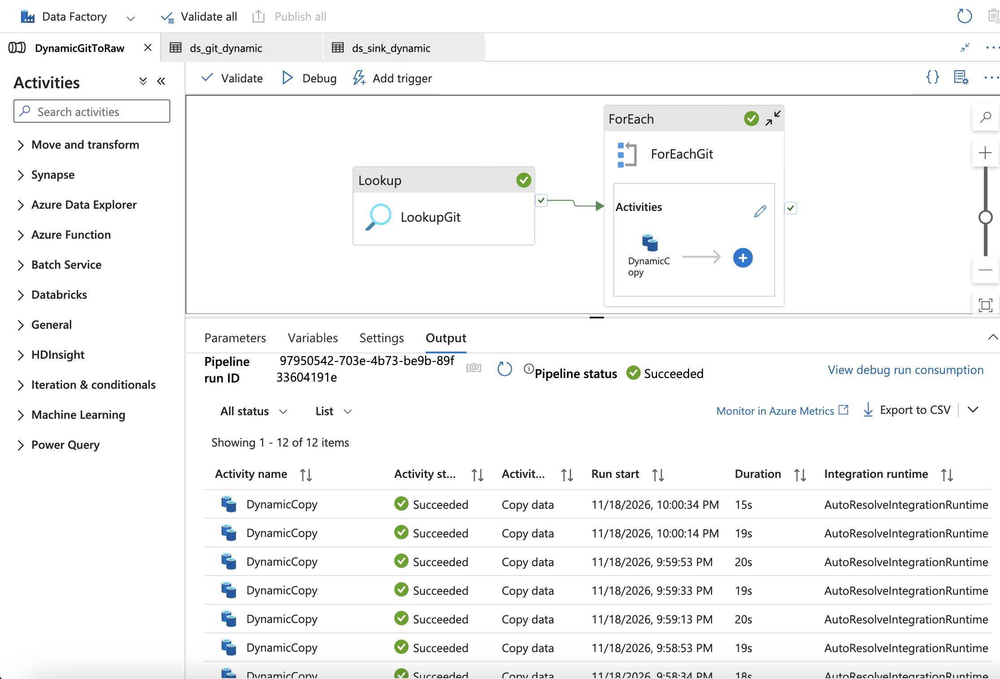
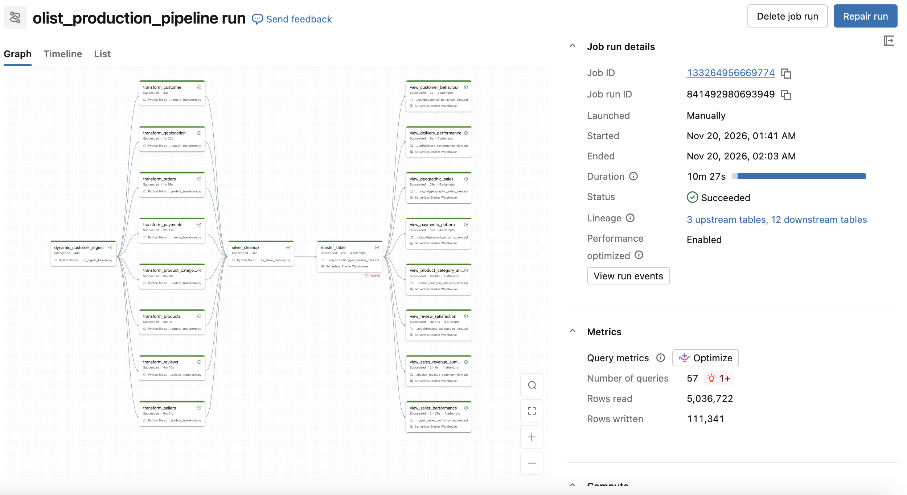
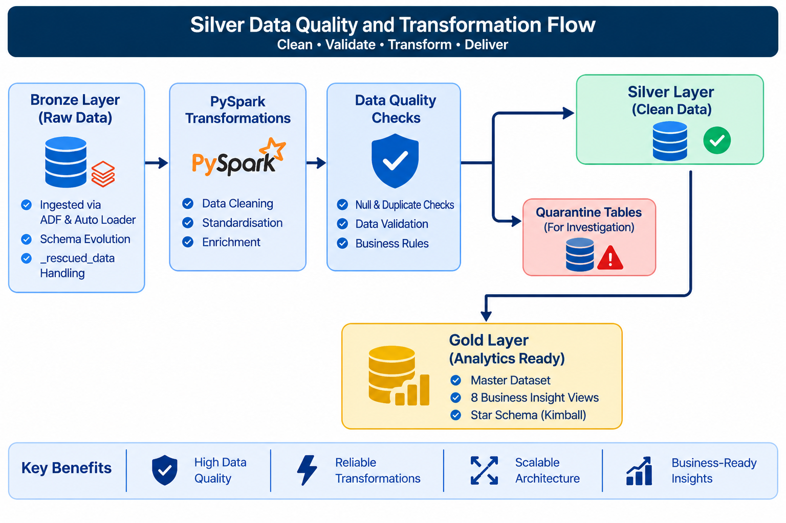

# Retail Data Engineering Project

An end-to-end retail data engineering project built using **Azure Data Factory, Azure Data Lake Storage Gen2, Azure Databricks, PySpark, SQL and Delta Lake**.

The project uses the Olist retail dataset to implement a Bronze, Silver and Gold Medallion architecture, covering dynamic data ingestion, data quality engineering, transformation pipelines, Incremental data ingestion and processing using Auto Loader, merge, update and a scheduled deletion handling at midnight. Kimball dimensional modelling, Star schema and analytical data preparation.

---

## 1. Architecture

## Architecture Diagram


The architecture illustrates the end-to-end flow of retail data from GitHub through Azure Data Factory into ADLS Gen2, followed by processing in Databricks and the production of curated Silver and Gold datasets.

## 2. Pipeline Implementation

### Azure Data Factory — Dynamic Data Ingestion

A metadata-driven ingestion pipeline retrieves source file information, iterates through the configured datasets and executes dynamic copy activities to transfer CSV files into ADLS Gen2 Bronze storage.

## Azure Data Factory Pipeline



*Successful pipeline execution showing the Lookup, ForEach and DynamicCopy activities.*

### Azure Databricks — Production Pipeline

The Databricks production workflow orchestrates Bronze ingestion, individual Silver transformations, Silver cleanup, Gold master dataset creation and eight downstream SQL business insight views.

## Databricks Production Pipeline



*Successful job execution showing task dependencies, transformations, analytical views and execution metrics.*

## Silver Data Quality and Transformation Flow

The diagram illustrates how Bronze data is cleaned and validated using PySpark. Valid records are written to Silver Delta tables and passed to Gold, while invalid records are separated into quarantine tables for investigation.

 

---

## 3. Engineering Implementation

### Bronze — Data Ingestion

* Dynamic ingestion of multiple source datasets.
* Incremental file ingestion using Databricks Auto Loader.
* Schema inference, schema hints and schema evolution.
* Ingestion metadata and `_rescued_data` handling for unexpected or incompatible source data.

### Silver — Data Quality and Transformation

* Advanced PySpark data cleaning and standardisation.
* Null, duplicate, invalid-value and consistency checks.
* Schema mismatch and corrupt-record handling.
* Quarantine tables for records requiring further investigation.
* Data validation and relationship checks between datasets.
* Delta Lake MERGE operations and incremental processing.

### Gold — Dimensional Modelling and Analytics

* Consolidated retail master dataset to support downstream analytical workloads.
* Kimball dimensional modelling using a star schema.
* Fact table development with dimension relationships.
* A/B testing of join strategies to evaluate read performance and compute efficiency.
* Eight SQL business insight views covering key retail performance areas.

### Business Insight Views

The Gold layer provides analytical views covering:

1. Customer behaviour
2. Delivery performance
3. Geographic sales
4. Payment patterns
5. Product category analysis
6. Review satisfaction
7. Sales revenue summary
8. Seller performance

---

## 4. Production Source Code

The production implementation is organised by Medallion layer.

### Bronze — Ingestion

* [Dynamic Bronze ingestion — PySpark](https://github.com/farzad-ha/retail-data-engineering-project/blob/main/src/production/bronze/dynamic_ingest_bronze.py)
* [Azure Data Factory dynamic ingestion configuration — JSON](https://github.com/farzad-ha/retail-data-engineering-project/blob/main/src/production/bronze/DataFactory_dynamic_ingestion/git.json)

### Silver — Transformations

* [Customers](https://github.com/farzad-ha/retail-data-engineering-project/blob/main/src/production/silver/customers_transform.py)
* [Geolocation](https://github.com/farzad-ha/retail-data-engineering-project/blob/main/src/production/silver/geolocation_transform.py)
* [Order items](https://github.com/farzad-ha/retail-data-engineering-project/blob/main/src/production/silver/order_items_transform.py)
* [Orders](https://github.com/farzad-ha/retail-data-engineering-project/blob/main/src/production/silver/orders_transform.py)
* [Payments](https://github.com/farzad-ha/retail-data-engineering-project/blob/main/src/production/silver/payments_transform.py)
* [Product category translation](https://github.com/farzad-ha/retail-data-engineering-project/blob/main/src/production/silver/product_category_name_translation_transform.py)
* [Products](https://github.com/farzad-ha/retail-data-engineering-project/blob/main/src/production/silver/products_transform.py)
* [Reviews](https://github.com/farzad-ha/retail-data-engineering-project/blob/main/src/production/silver/reviews_transform.py)
* [Sellers](https://github.com/farzad-ha/retail-data-engineering-project/blob/main/src/production/silver/sellers_transform.py)

### Gold — Master Dataset and Analytical Views

* [Master dataset](https://github.com/farzad-ha/retail-data-engineering-project/blob/main/src/production/gold/master_data.sql)
* [Customer behaviour](https://github.com/farzad-ha/retail-data-engineering-project/blob/main/src/production/gold/customer_behaviour_view.sql)
* [Delivery performance](https://github.com/farzad-ha/retail-data-engineering-project/blob/main/src/production/gold/delivery_performance_view.sql)
* [Geographic sales](https://github.com/farzad-ha/retail-data-engineering-project/blob/main/src/production/gold/geographic_sales_view.sql)
* [Payment patterns](https://github.com/farzad-ha/retail-data-engineering-project/blob/main/src/production/gold/payment_patterns_view.sql)
* [Product category analysis](https://github.com/farzad-ha/retail-data-engineering-project/blob/main/src/production/gold/product_category_analysis_view.sql)
* [Review satisfaction](https://github.com/farzad-ha/retail-data-engineering-project/blob/main/src/production/gold/review_satisfaction_view.sql)
* [Sales revenue summary](https://github.com/farzad-ha/retail-data-engineering-project/blob/main/src/production/gold/sales_revenue_summary_view.sql)
* [Seller performance](https://github.com/farzad-ha/retail-data-engineering-project/blob/main/src/production/gold/seller_performance_view.sql)

---

## 5. Repository Structure

```text
├── notebooks/              # Development and exploration
├── src/
│   ├── staging/            # Staging implementations
│   └── production/
│       ├── bronze/         # Data ingestion
│       ├── silver/         # Data quality and transformations
│       └── gold/           # Master dataset and SQL views
└── docs/                   # Architecture and pipeline screenshots
```

## 6. Technology Stack

**Cloud:** Azure Data Factory, Azure Data Lake Storage Gen2

**Data Engineering:** Azure Databricks, PySpark, Python, SQL

**Data Storage and Processing:** Delta Lake, Auto Loader

**Architecture:** Medallion Architecture, Kimball Dimensional Modelling, Star Schema
